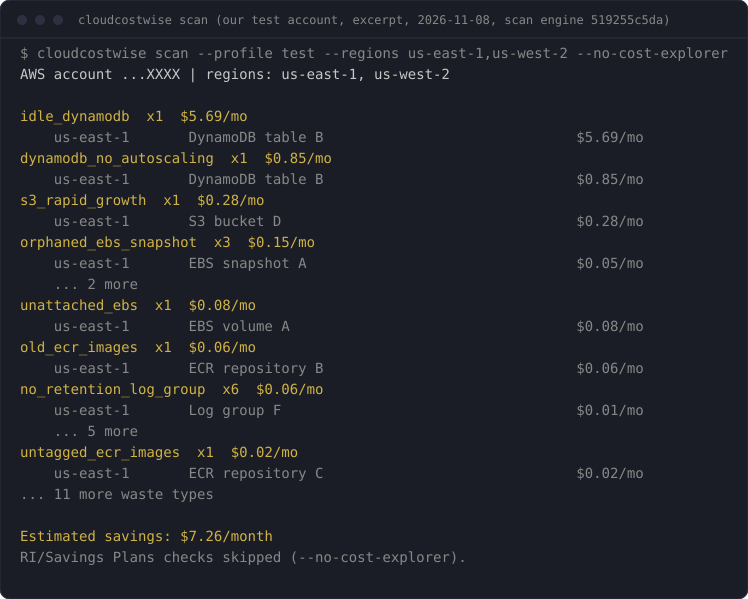

# cloudcostwise

<!-- mcp-name: io.github.cloudwise-app/cloudcostwise -->

[](https://pypi.org/project/cloudcostwise/)
[](https://pepy.tech/projects/cloudcostwise)

[](#use-it-from-claude-code-codex-or-any-mcp-client)


[](https://github.com/cloudwise-app/cloudcostwise/blob/v0.1.22/LICENSE.md)

Find AWS waste from your terminal or your AI assistant. `cloudcostwise` runs CloudWise's free waste
checks on your own machine, with your own read-only AWS credentials.

**Before you run it with AWS credentials:**

- **It cannot change your account.** Every AWS call a scan makes is checked, and anything that isn't a
  `Describe`, `List`, `Get`, `Search` or `Lookup` is refused before it is sent, whatever your credentials allow.
- **It talks to AWS and nothing else, unless you say yes.** After the first scan in a terminal it asks once
  whether to share a summary (the CLI version, finding count, estimated savings and checks run, printed
  before it asks; never account IDs, resource names, regions or ARNs). The default is no. `cloudcostwise share --off`
  turns it off for good; `CLOUDCOSTWISE_SHARE=no` turns it off for that environment. See [Sharing a summary](#sharing-a-summary-optional).
- **Through an AI assistant (MCP), the findings, including your account ID and resource IDs, go to that
  assistant** like any tool output.
- **It is not quite free to run.** The RI/Savings Plans checks call Cost Explorer, which AWS bills at
  $<!-- fact:costExplorer.pricePerRequestUsd -->0.01<!-- /fact --> a request, about
  $<!-- fact:costExplorer.perScanUsd -->0.09<!-- /fact --> a scan. `--no-cost-explorer` skips them.
- **It stores up to two small files:** your share answer in `~/.config/cloudcostwise/share.json` and, only if you use `cloudcostwise exclude`, your exclude list in `~/.config/cloudcostwise/exclude.json` (it never leaves your machine). No report, cache or credentials are written.
- **Open source (Apache-2.0).** Read the code: [github.com/cloudwise-app/cloudcostwise](https://github.com/cloudwise-app/cloudcostwise).

Least-privilege IAM policy (<!-- fact:iam.cliPolicyActionCount -->71<!-- /fact --> read-only actions):
[`docs/iam-policy.json`](https://github.com/cloudwise-app/cloudcostwise/blob/v0.1.22/docs/iam-policy.json). See a real scan first, no credentials needed:
[cloudcostwise.io/sample-scan](https://cloudcostwise.io/sample-scan?utm_source=github&utm_medium=referral&utm_campaign=readme).

- **<!-- fact:detectors.free -->20<!-- /fact --> of CloudWise's <!-- fact:detectors.total -->46<!-- /fact --> service checks**: EC2, Lambda, SageMaker, WorkSpaces,
  Lightsail, EBS, S3, EFS, ECR, RDS, DynamoDB, ElastiCache, Elastic IPs, NAT
  gateways and load balancers, VPC endpoints, dangling DNS records, CloudWatch
  logs and dashboards, security posture, RI/Savings Plans opportunities, and
  Compute Optimizer.



## Install and run

```bash
pipx install cloudcostwise          # or: uvx cloudcostwise scan
cloudcostwise scan                      # us-east-1 plus your profile's region
cloudcostwise scan --profile prod --regions all
cloudcostwise scan --format json > waste.json
cloudcostwise scan --format json --anonymize > waste-to-share.json   # then read it through before you email it
```

Options:

| Option | Meaning |
|---|---|
| `--profile NAME` | AWS profile; otherwise the standard credential chain (env vars, SSO, instance role) |
| `--regions LIST` | Comma-separated regions, or `all` for every enabled region. Account-level checks (CloudWatch dashboards, orphaned DNS records, RI/Savings Plans) run once, in us-east-1, and are skipped with a warning if it is not listed |
| `--format table\|markdown\|json` | Output format |
| `--anonymize` | Replace the account ID and the resource IDs, names, ARNs and tag values it recognizes with stable placeholders (`account-1`, `resource-1`, ...; the same value always gets the same one). Waste type, region, savings, confidence, action wording, warnings and counts stay. Works with every `--format`; it runs locally and sends nothing. **Anonymizing is not complete:** it replaces the identifiers it recognizes, so review the file before you send it |
| `--no-exclude` | Ignore your exclude list (see below) for this run and show every finding |
| `--no-cost-explorer` | Make no Cost Explorer call. AWS bills those at $<!-- fact:costExplorer.pricePerRequestUsd -->0.01<!-- /fact --> per request and a scan makes about <!-- fact:costExplorer.requestsPerScan -->9<!-- /fact -->. Skips the RI/Savings Plans checks and the one request that reads your last 30 days of spend, so the score falls back to "without spend data" |
| `--parallel N` | Regions scanned at once, each in its own process (default <!-- fact:cli.defaultParallel -->4<!-- /fact -->; `--regions all` takes ~2–3 min instead of ~10) |
| `--verbose` | Show data warnings (checks that could not read a metric report it as missing, never as zero) |

## Leave resources out of every scan

A finding you have already decided to keep (a bucket that looks idle but is not, a snapshot you retain on purpose)
can go on a local exclude list that survives the next run:

```bash
cloudcostwise exclude add vol-0abc123def4567890 --reason "kept for the audit"   # a resource ID or a full ARN
cloudcostwise exclude list
cloudcostwise exclude remove vol-0abc123def4567890
cloudcostwise scan --no-exclude                                                   # ignore the list for one run
```

- **Matching:** an identical ID always matches. An ARN you add matches a finding whose ID is that resource's name (the scan
  reports an RDS instance, Lambda function, log group, load balancer or DynamoDB table by its bare name) or an ARN of the same
  service and name (a load balancer is named by its name, not the hash in its ARN). A bare ID matches the ARN form
  only when it is AWS-shaped (`vol-...`, `snap-...`, `i-...`); a plain name such as `default` or `mydb` matches only an identical
  ID, so it cannot hide unrelated resources. To hide a resource the scan reports by name, add either its name or its ARN.
- **The partner build ignores this list** (its CLI and MCP never apply it).
- **Every scan reads `~/.config/cloudcostwise/exclude.json` fresh** (next to `share.json`) and leaves matching findings out of the
  table, Markdown, JSON and MCP output and out of the savings total and the score. It says how many under "Left out on
  purpose" ("2 findings left out by your exclude list (cloudcostwise exclude list)"); the JSON adds
  `excluded_by_list_count` and `excluded_by_list_resource_ids`.
- **With `--anonymize`**, the exclusion happens first; the excluded IDs are still scrubbed from warnings and notes, and the JSON list of excluded IDs is emptied, so none is printed; the count stays. `--verbose` lists the excluded IDs under "Left out on purpose" (table and Markdown) when you are not anonymizing.
- **The list is never sent to CloudWise.** The optional shared summary counts what the report showed, after exclusions, and never includes the list.
- A missing file is an empty list. A file that cannot be read is treated as empty with a warning on stderr; the scan still runs, and `exclude add` leaves that file alone until you fix or delete it.

## What AWS's free tools don't flag

<!-- aws-gap:start (generated by scripts/aws_gap.py) -->
This tool has 54 proven checks (L2 or above in [VALIDATION.md](https://github.com/cloudwise-app/cloudcostwise/blob/v0.1.22/VALIDATION.md): each fired on a real AWS resource built to trigger it and stayed silent on a healthy twin). **19 of them flag waste that none of AWS's own tools flag**, and 12 more go further than the closest AWS check, going by AWS's lists of what its tools cover ([Trusted Advisor](https://docs.aws.amazon.com/awssupport/latest/user/trusted-advisor-check-reference.html), [Cost Optimization Hub](https://docs.aws.amazon.com/cost-management/latest/userguide/cost-optimization-hub.html), [Compute Optimizer](https://docs.aws.amazon.com/compute-optimizer/latest/ug/supported-resources.html); checked 2026-10-11).

| Check | What it finds | Closest AWS check |
|---|---|---|
| `ami_orphaned_snapshot` | EBS snapshots left behind by an AMI that was deregistered | None |
| `classic_lb_migration` | Classic Load Balancers that would cost less as an ALB or NLB | None |
| `elasticache_data_tiering_opportunity` | Redis OSS or Valkey replication groups on r6g/r7g nodes that would cost less on data-tiering r6gd nodes | None |
| `elasticache_engine_migration` | Redis OSS or Memcached clusters that would cost about 20% less on Valkey | None |
| `elasticache_extended_support_cost` | ElastiCache engine versions billed the Extended Support surcharge | None |
| `empty_log_group` | CloudWatch log groups that have stored nothing for 30+ days | None |
| `idle_lightsail` | Stopped or idle Lightsail instances that still bill their bundle price | None |
| `lambda_arm64_migration` | Lambda functions that would cost about 20% less on arm64 (Graviton) | None |
| `lambda_provisioned_concurrency_idle` | Lambda provisioned concurrency that is paid for and barely used | None |
| `lightsail_idle_load_balancer` | Idle Lightsail load balancers | None |
| `lightsail_unattached_disk` | Lightsail disks attached to nothing | None |
| `lightsail_unattached_static_ip` | Lightsail static IPs attached to nothing | None |
| `low_traffic_alb` | Application Load Balancers carrying almost no traffic | None |
| `multiple_eips_per_instance` | Extra Elastic IPs on one instance, each billed as a public IPv4 address | None |
| `no_lifecycle_efs` | Large EFS file systems with no Infrequent Access or Archive tiering | None |
| `orphaned_ebs_snapshot` | EBS snapshots whose source volume no longer exists | None |
| `previous_gen_sagemaker_instance` | SageMaker instances on a previous generation with a cheaper current one | None |
| `s3_empty_bucket` | Empty S3 buckets left behind for 30+ days | None |
| `stopped_sagemaker_notebook_storage` | Stopped SageMaker notebook instances whose ML storage volume keeps billing | None |
| `dynamodb_no_autoscaling` | Provisioned DynamoDB tables with no auto scaling on their read or write capacity | Idle recommendation for DynamoDB provisioned tables: Compute Optimizer (and Cost Optimization Hub) look at the same provisioned tables, but only flag ones with no consumed capacity at all. Security Hub CSPM control DynamoDB.1 (tables should scale capacity with demand) checks for auto scaling, but it is an availability control with no cost wording, and its Recover > Resilience category is one Trusted Advisor does not show (checked 2026-11-05). |
| `elasticache_replication_waste` | Replicas kept on non-production ElastiCache replication groups, each billed like a full node | Amazon ElastiCache Multi-AZ clusters: Trusted Advisor's check looks at the same clusters with the opposite aim, alerting when Multi-AZ is inactive and recommending at least one replica per shard. Compute Optimizer, the source of Cost Optimization Hub's idle recommendations, calls a Redis or Valkey cluster idle only when all its nodes are idle over 14 days. None of the three tools documents a check for replicas on a non-production group that is in use (checked 2026-11-02). |
| `excessive_retention_log_group` | Log groups keeping a year or more of data they are billed to store | Amazon CloudWatch Log Group Retention Period: Trusted Advisor checks log group retention but flags retention shorter than a minimum (365 days by default) for compliance, so long, costly retention passes it. |
| `idle_efs` | EFS file systems with no mount targets: nothing can read them, and they still bill | Amazon EFS no mount target redundancy: Trusted Advisor checks EFS mount targets for multi-AZ redundancy, not file systems with no mount targets at all, and EFS is not among the resources Compute Optimizer or Cost Optimization Hub cover. |
| `idle_load_balancer` | Idle Application and Network Load Balancers | Idle Load Balancers: Trusted Advisor flags idle Classic Load Balancers only (Business Support+ or higher); its documentation says Application and Network Load Balancers are not included. |
| `incomplete_multipart` | Incomplete S3 multipart uploads whose stored parts keep billing | Amazon S3 Incomplete Multipart Upload Abort Configuration: Trusted Advisor flags buckets whose lifecycle configuration lacks a rule to abort incomplete multipart uploads after 7 days; it does not find the incomplete uploads that are already stored and billing. |
| `lambda_excessive_timeout` | Lambda timeouts set far above what the function needs | AWS Lambda functions with excessive timeouts: Trusted Advisor flags functions where more than 10% of invocations time out; it does not flag a configured timeout set far above the function's real duration. |
| `no_retention_log_group` | Log groups set to never expire, so they grow every month | Amazon CloudWatch Log Group Retention Period: Trusted Advisor checks log group retention but flags retention below a minimum, so a log group set to never expire passes it. |
| `old_ecr_images` | Old ECR images still billed for storage | Amazon ECR Repository without lifecycle policy configured: Trusted Advisor checks that an ECR repository has a lifecycle policy; it does not flag the old images already stored. |
| `oversized_sagemaker_endpoint` | SageMaker endpoints serving traffic on bigger instances than they need | Idle recommendation for SageMaker endpoints: Compute Optimizer flags SageMaker endpoints with zero invocations over 14 days but gives no rightsizing for endpoints that serve traffic on oversized instances. |
| `s3_rapid_growth` | S3 buckets whose Standard storage at least doubled in 30 days and grew by 10 GB or more | Amazon S3 Bucket Lifecycle Policy Configured: Trusted Advisor's S3 cost checks (lifecycle policy configured, incomplete multipart upload abort, version-enabled buckets without a lifecycle policy) look at bucket configuration, not at how fast a bucket is growing. Neither Compute Optimizer nor Cost Optimization Hub lists S3 among its resource types, so none of the three tools documents a check for a bucket that grows quickly (checked 2026-11-03). |
| `untagged_ecr_images` | Untagged ECR images still billed for storage | Amazon ECR Repository without lifecycle policy configured: Trusted Advisor checks that an ECR repository has a lifecycle policy; it does not flag the untagged images already stored. |

For idle EC2, RDS and NAT gateways, rightsizing and Savings Plans, AWS's tools cover the same ground: use them too. Trusted Advisor's cost checks need a Business, Enterprise or Unified Operations support plan; Cost Optimization Hub and Compute Optimizer are free.

The hosted CloudWise product adds 23 more proven checks that none of AWS's tools flag, across AWS Backup, AppSync, CloudFront, Elastic Beanstalk, FSx, Glue, KMS, Kinesis, Route 53, Step Functions.
<!-- aws-gap:end -->

<!-- facts-lint: allow dated capture of a real scan -->
Excerpt of a real scan of our test account (cloudcostwise 0.1.15, us-east-1, 2026-10-27).
The resources there are deliberately tiny, which is why the amounts are cents:

```text
no_retention_log_group  x6  $0.06/mo
    us-east-1       /aws/lambda/cwfx-clo464-docdb-connect                               $0.01/mo
    us-east-1       /aws/lambda/cwfx-ec-hold-driver                                     $0.01/mo
    us-east-1       /aws/sagemaker/Endpoints/cwfx-w8b-ep-big                            $0.01/mo
    us-east-1       /aws/sagemaker/Endpoints/cwfx-w8b-ep-big-control                    $0.01/mo
    us-east-1       /aws/sagemaker/Endpoints/cwfx-w8b-ep-idle                           $0.01/mo
    us-east-1       /aws/sagemaker/Endpoints/cwfx-w8b-ep-idle-control                   $0.01/mo
old_ecr_images  x1  $0.06/mo
    us-east-1       cwfx-old-ecr-images                                                 $0.06/mo
untagged_ecr_images  x1  $0.02/mo
    us-east-1       cwfx-untagged-ecr-images                                            $0.02/mo
idle_efs  x1  $0.01/mo
    us-east-1       fs-090bfb32bd49de8b7                                                $0.01/mo
```

## Use it from Claude Code, Codex or any MCP client

`cloudcostwise mcp` runs the same scan as an MCP server (stdio). Then ask your
assistant: *"Where am I wasting money on AWS?"*

The plugin and registry entries start the server with `uvx`, so install
[uv](https://docs.astral.sh/uv/) first (`brew install uv` or `pipx install uv`).

Claude Code, as a plugin (asks for your AWS profile):

```text
/plugin marketplace add cloudwise-app/cloudcostwise
/plugin install cloudcostwise@cloudcostwise
```

Claude Code, as a plain MCP server:

```bash
claude mcp add cloudcostwise -- uvx cloudcostwise mcp
# a specific profile:
claude mcp add cloudcostwise -e AWS_PROFILE=prod -- uvx cloudcostwise mcp
```

Codex (`~/.codex/config.toml`):

```toml
[mcp_servers.cloudcostwise]
command = "uvx"
args = ["cloudcostwise", "mcp"]
env = { AWS_PROFILE = "prod" }
```

Tools, all read-only: `scan`, `list_findings`, `explain_finding`,
`fix_guidance`. `fix_guidance` returns the steps and AWS CLI command as text
for you to review; nothing is ever executed. The assistant is told about the
Cost Explorer cost before it scans, and `include_cost_explorer=false` skips it.

Resources are read-only views of the last scan held by the running server.
Reading one never starts a scan or calls AWS; before the first scan they say so:

- `cloudcostwise://scan/latest`: the last scan's findings as JSON.
- `cloudcostwise://scan/latest/summary`: the one-screen text summary.
- `cloudcostwise://checks`: the checks and the waste types each can report.

Prompts appear in the slash menu of clients that support them: `scan-account`
(optional `profile` and `regions`), `explain-finding` and `fix-guidance` (each
takes a `finding_id`). None asks the assistant to change anything in AWS. In
Claude Code, `/mcp__cloudcostwise__fix-guidance` with a finding id from
`list_findings` presents the guidance with the read-only caveat first.

## Permissions

The minimal policy the checks use is
in [`docs/iam-policy.json`](https://github.com/cloudwise-app/cloudcostwise/blob/v0.1.22/docs/iam-policy.json). AWS-managed `ReadOnlyAccess` also works, but it is much broader than the scan needs. It was derived from a scan of
an account with most supported resource types; if a check lacks a permission,
the scan says so in its data warnings instead of failing.

One of those reads, `lambda:ListFunctions`, returns each function's environment variables as plain text. The scan reads only
sizing and configuration fields and none of those values reaches a finding, a report or a file, but anyone holding the role can read them.

## Sharing a summary (optional)

The default is no. After a scan prints, and only when both your input and output are a terminal, the CLI
may ask once whether to share a summary with CloudWise. It prints exactly what it would send before it asks:
the CLI version, the number of findings, the estimated monthly savings and the number of checks run. Never
account IDs, resource IDs or names, regions, ARNs or tags.

Two further, separate yeses, asked only at that interactive prompt and only if you type an email address:
"please email me about this report" (nothing from the report is uploaded; you can produce it yourself with
`--format markdown`) and "tell me when new checks land" (marketing email; we confirm by reply before
adding you to anything, and you can withdraw consent at any time by replying to or emailing cloudwise@cloudcostwise.io). Answer once and it does not ask again on
that machine.

```bash
cloudcostwise share --status       # what is set
cloudcostwise share --off          # never ask, never send
cloudcostwise share --on           # send a summary after each scan
cloudcostwise share --reset        # forget the answer and ask once more
```

Without a terminal (a pipe, CI, a script) nothing is asked and nothing is sent unless you set
`CLOUDCOSTWISE_SHARE=yes` (or `no`) yourself, or write `~/.config/cloudcostwise/share.json`. Those settings
carry the summary only (the CLI version, finding count, estimated savings and checks run, plus whether the scan came from the CLI or MCP), never an email address. The MCP server
never prompts, its `scan` tool has no sharing parameter, and it sends only when one of those settings says yes.
A failed or slow connection is ignored (about 3 seconds at most, after the results are printed).

## How the numbers are counted

Each finding shows an estimated monthly saving. **Advisory** waste types, ones
CloudWise could not validate against a real AWS resource, are listed but never
added to the total.

## For consultancies and MSPs

The partner licence runs on your own machine like this tool: the other <!-- fact:detectors.hostedOnly -->26<!-- /fact --> service
checks, one scan across every client account, and a client report under your
firm's name. One price per firm, unlimited client accounts:
<https://cloudcostwise.io/partners?utm_source=cloudcostwise&utm_medium=readme>.

## What the hosted product adds

The other <!-- fact:detectors.hostedOnly -->26<!-- /fact --> service checks (Glue, ECS, Step Functions, Backup, CloudFront,
commitments and more), history and trends, alerts, and safe automated fixes:
<https://cloudcostwise.io/connect?utm_source=cloudcostwise&utm_medium=cli>.

## Tell us where it's wrong

A false positive, a miss, or a dollar figure that looks off: post it in
[issue #1](https://github.com/cloudwise-app/cloudcostwise/issues/1), or email
cloudwise@cloudcostwise.io if you'd rather not post in public. The waste types and
counts from your scan are enough. Leave out account IDs and resource names.
Every report gets a reply, and a confirmed false positive gets fixed in the
next release.

## License

Open source under the Apache License 2.0 (see [LICENSE.md](https://github.com/cloudwise-app/cloudcostwise/blob/v0.1.22/LICENSE.md)). 0.1.18 and later are Apache-2.0.
0.1.17 and earlier are FSL-1.1-ALv2 (each becomes Apache-2.0 two years after it ships).

## How we know it's right

See [VALIDATION.md](https://github.com/cloudwise-app/cloudcostwise/blob/v0.1.22/VALIDATION.md): the validation level of every waste type this tool reports, from L0 (unit-tested) to L2 (fired on a real AWS resource and stayed silent on a healthy twin) and beyond.
